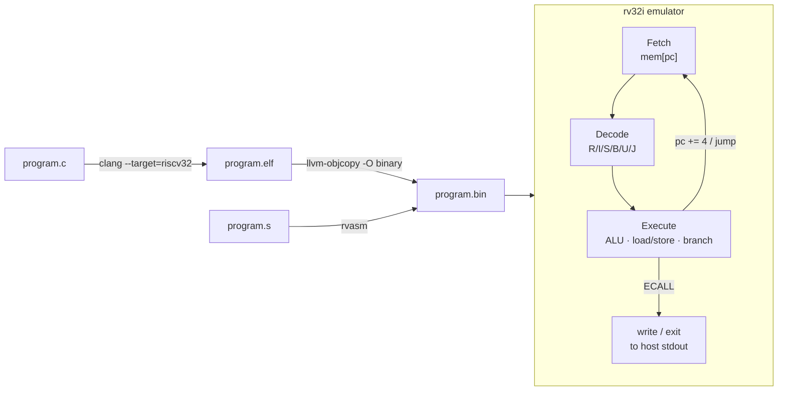

# rv32i-emu

A RISC-V **RV32I** emulator and a two-pass assembler, written from scratch in C11 with no dependencies.

It runs real C programs compiled by LLVM for RISC-V, and it comes with its own assembler. On a test file that covers every instruction, the assembler's output is byte-identical to LLVM's.

```
$ make run
./rv32i programs/hello.bin
Merhaba! Bu program benim assembler'imla derlendi.
1 + 2 + ... + 100 = 5050 (dogru)
[rv32i] 671 komut calistirildi, cikis kodu 0

./rv32i programs/fib.bin
Fibonacci dizisi:
0 1 1 2 3 5 8 13 21 34 55 89 144 233 377 610 987 1597 2584 4181 6765 10946 17711 28657 46368
[rv32i] 33958 komut calistirildi, cikis kodu 0

./rv32i programs/primes.bin
1000'e kadar asal sayilar:
2 3 5 7 11 13 17 19 23 29 31 37 41 43 47 ... 983 991 997
Toplam: 168 asal sayi
[rv32i] 248745 komut calistirildi, cikis kodu 0
```

## Features

**Emulator (`rv32i`)**
- The full RV32I base integer instruction set: all 40 instructions (ALU, loads/stores, branches, `JAL`/`JALR`, `LUI`/`AUIPC`, `FENCE`, `ECALL`, `EBREAK`)
- 32 registers with hard-wired `x0`, a little-endian byte-addressable memory of 1 MiB, and bounds checking on every access
- Linux-style system calls through `ECALL`: `write` (64) and `exit` (93)
- Runs freestanding C programs that LLVM compiles to `riscv32`, using a small runtime (`crt0`, `print_*`, and software `__mulsi3`/`__udivsi3`/... because RV32I has no multiply or divide instructions)
- Reports an error, then dumps the registers, on an illegal instruction, a misaligned jump target, or an out-of-bounds memory access

**Assembler (`rvasm`)**
- A two-pass assembler: pass 1 sizes each line and resolves labels, pass 2 emits the machine code
- All 40 RV32I instructions, ABI register names (`a0`, `sp`, `ra`, ...) and `x0`–`x31`
- Pseudo-instructions: `li`, `la`, `mv`, `j`, `jr`, `call`, `ret`, `beqz`, `bnez`, `not`, `neg`, `nop`
- The directives `.word`, `.byte`, `.asciz`/`.string` and `.align`
- Error messages that give the line number, for example `satir 2: hata: 12 bitlik sabit aralik disinda: 5000`
- A listing mode (`-l`) that prints the address, the encoding and the source line of each instruction

## Architecture



| File | Role |
|---|---|
| `src/cpu.c`, `cpu.h` | CPU state: registers, PC, memory and its accessors |
| `src/decode.c`, `decode.h` | Splits a 32-bit instruction into its fields and builds the sign-extended immediate for each format |
| `src/execute.c` | The fetch–decode–execute step and the system calls |
| `src/main.c` | Loads a raw binary at address 0 and runs it |
| `tools/rvasm.c` | The assembler |
| `programs/` | Example programs: `crt0.S`, the runtime, the linker script, C programs and an assembly program |
| `tests/test_cpu.c` | Unit tests for the emulator, written as a hand-encoded program with expected register values |
| `tests/asm/all_instr.s` | Compatibility test for the assembler against LLVM |

## Build and run

Requirements: a C compiler (`clang` or `gcc`) and `make`. Building the C example programs also requires LLVM and lld, which provide the RISC-V cross-compiler:

```bash
brew install llvm lld        # macOS; on Linux use your package manager
```

```bash
make            # builds rv32i and rvasm
make test       # emulator unit tests
make asm-check  # rvasm output vs. LLVM, compared byte for byte
make run        # builds and runs every example program
```

To run your own C program, include `runtime.h`, then:

```bash
make programs/myprog.bin && ./rv32i programs/myprog.bin
```

To assemble and run your own assembly file:

```bash
./rvasm -l myprog.s myprog.bin && ./rv32i myprog.bin
```

## Design notes

- **Immediate decoding.** The six instruction formats scatter the immediate bits differently. RISC-V does this deliberately, so that `rs1`, `rs2` and `rd` always sit in the same bit positions and the hardware can read registers before decoding finishes. A single helper, `sign_extend(value, width)`, sign-extends the immediate for every format.
- **Signed vs. unsigned.** `SLT`/`SLTU`, `BLT`/`BLTU`, `SRA`/`SRL` and `LB`/`LBU` each operate on the same bits and differ only in how they interpret them, which the code handles with explicit `int32_t`/`int8_t` casts.
- **`JALR`.** The target address is computed before `rd` is written, because `rd` can be the same register as `rs1`.
- **No hardware multiply.** RV32I has no `MUL` or `DIV`, so the compiler turns `*`, `/` and `%` into calls to `__mulsi3`, `__udivsi3` and related helpers. The runtime implements them with shift-and-add and binary long division.
- **`li` with large constants.** The assembler splits the value into `lui hi` + `addi lo`. Because `addi` sign-extends its 12-bit immediate, `hi` is computed as `(value + 0x800) >> 12`.
- **Assembler testing.** `tests/asm/all_instr.s` contains every instruction, forward and backward branches, and the edge cases of the immediate ranges. `make asm-check` assembles the file with both `rvasm` and LLVM and compares the two outputs with `cmp`.

## Roadmap

- [ ] `M` extension (hardware `MUL`/`DIV`)
- [ ] `--trace` mode that prints each executed instruction
- [ ] Pass the official [riscv-tests](https://github.com/riscv-software-src/riscv-tests) suite
- [ ] Load ELF files directly, without the `objcopy` step
- [ ] A disassembler that reuses the decoder

## License

MIT, see [LICENSE](LICENSE).
